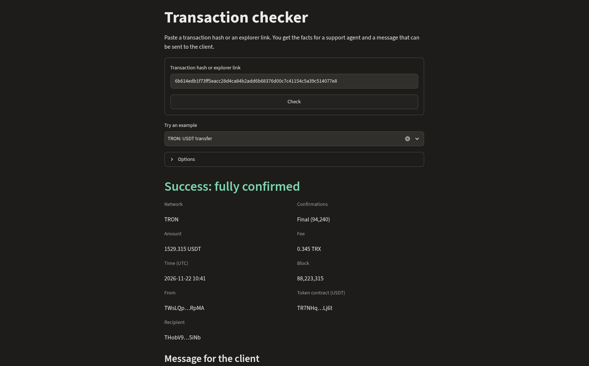
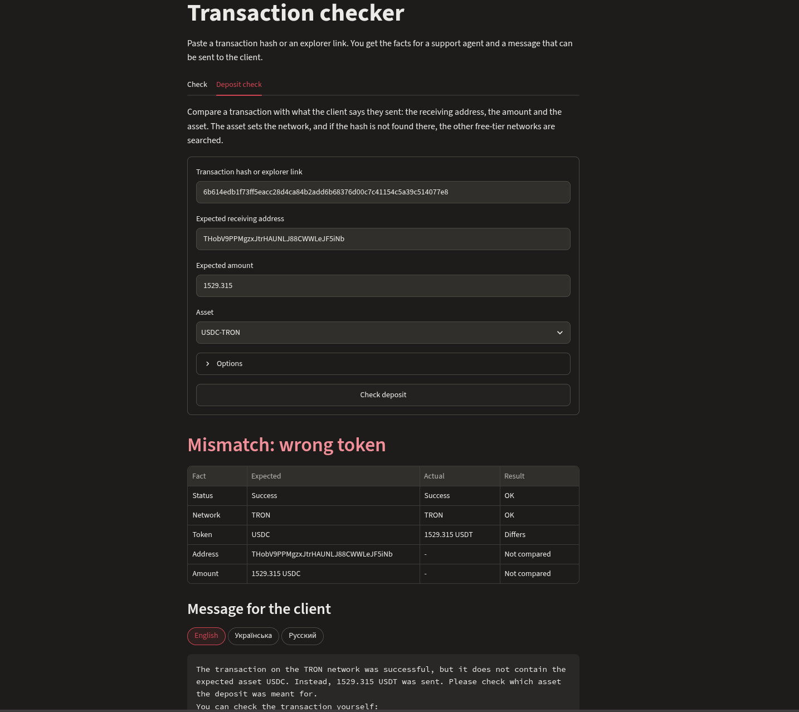
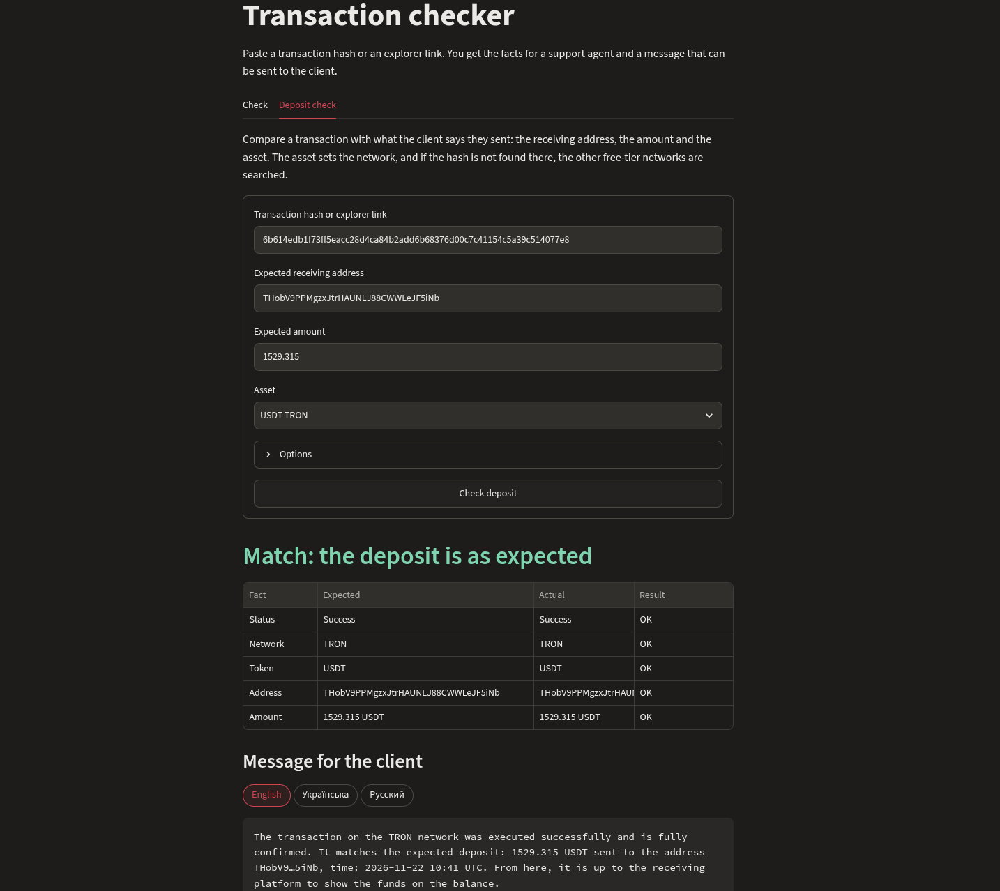
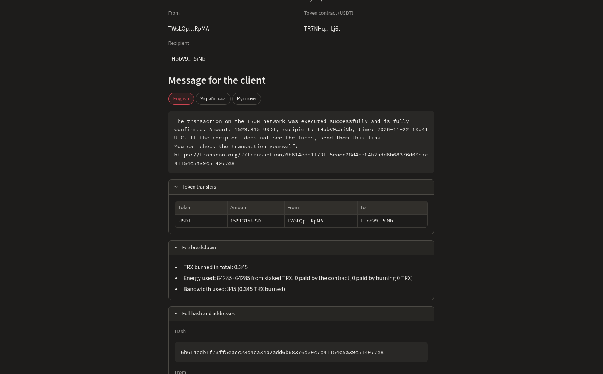
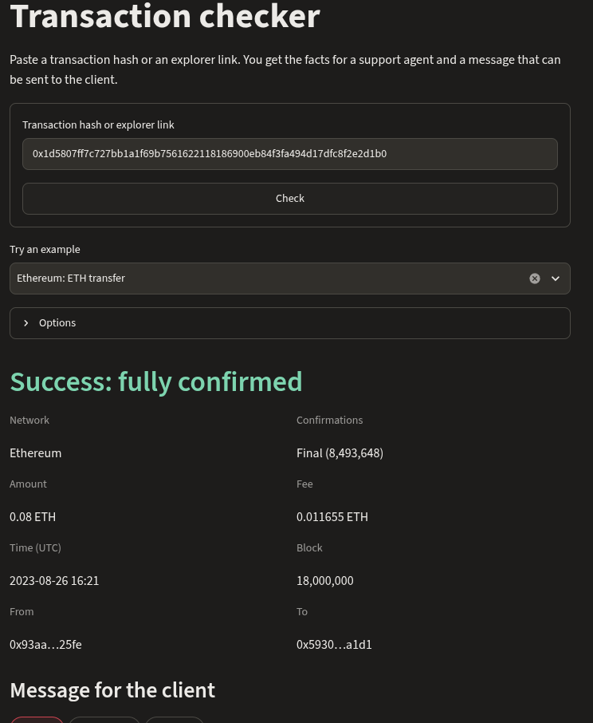
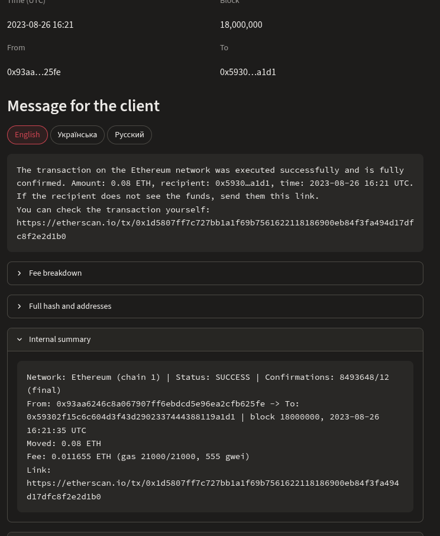

# tx-checker

Check a crypto transaction by its hash (EVM chains and TRON) and get a plain-language explanation for a support agent and a ready-to-send message for the client. A second mode checks a deposit: does the transaction match the address, amount and asset the client says they sent?

Live demo: https://tx-checker.streamlit.app/

The demo runs on Streamlit Community Cloud's free tier and may sleep after a period without visits. If you see a "wake up" button, click it and wait about 30 seconds.



## Why this exists

A block explorer shows everything about a transaction, but only in a form that makes sense if you already know how the chain works: gas limits, energy, revert codes, confirmation counts. Answering a simple question like "where is my USDT?" means reading that data correctly and then explaining it without jargon and without promising anything the blockchain doesn't show.

tx-checker does both steps. It reads a transaction by hash on EVM chains or TRON, works out the facts (status, confirmations, the actual fee, what was or wasn't transferred) and produces a short summary for a support agent plus a ready-to-send message for the client in English, Ukrainian or Russian. It also flags cases where a quick answer could go wrong, such as a fake "USDT" token or an older version of USDC.

## Features

- Accepts a bare hash or a full explorer link (Etherscan and the other supported explorers, Tronscan) and detects the network.
- Reports status (success, failed, pending, not found), confirmations, the real fee and the native and token transfers.
- Explains why a transaction failed: out of gas or out of energy, or rejected by the contract.
- Shows the fee the way each network charges it: gas for EVM, energy, bandwidth and burned TRX for TRON.
- Recognises USDT and USDC by contract address, never by the name the explorer reports.
- Warns about lookalike tokens, older versions of a token, unknown tokens, low confirmations, a guessed network and more.
- Writes an internal summary (English) and a client message (English, Ukrainian or Russian). The client message states only what the chain shows and never promises funds, refunds or timing.
- **Deposit check:** compares a transaction with the expected address, amount and asset and gives one of four verdicts (match, waiting for confirmations, mismatch with the reasons, inconclusive). It catches a wrong network, a wrong token, a wrong address and a lower or higher amount, and it says when a recipient address looks like the expected one with a different middle (a pattern used in address poisoning).
- **Wrong-network search:** if the hash is not on the network the asset implies, the other free-tier mainnets are searched, so "I sent it on the wrong network" is answered with the network where it was found.
- Two interfaces over the same core: a command-line tool with documented exit codes and JSON output, and a Streamlit web demo with a tab for each mode that works on a phone.
- The demo protects its API keys with input validation, a result cache, per-session and app-wide rate limits and a daily cap per provider. Provider calls are counted as they are made, so a hash that is not found costs one call.

## How it works

**Two kinds of network.** Ethereum and similar chains (EVM) and TRON handle fees differently, and that is what most support questions are about.

**EVM fees (gas).** Every operation costs gas. The sender sets a gas limit, the maximum they are willing to use, and a price per unit. The fee is the gas actually used times the price, and it is paid even when the transaction fails. If the gas runs out before the work is done, the transaction fails with "out of gas". If the contract itself rejects the call, it is "reverted". Both cost the fee, and neither moves the funds.

**TRON fees (energy and bandwidth).** TRON uses two resources. Bandwidth pays for sending any transaction. Energy pays for running smart contracts, which includes every USDT transfer. A wallet gets them for free by staking TRX. When there is not enough, the network burns TRX from the wallet to cover the rest. A failed contract call still burns the energy it used. If the energy runs out, the transaction fails with "out of energy".

**Token transfers.** A USDT or USDC transfer is a call to the token's contract. So the `to` field of the transaction is the token contract, not the person who receives the money. The real recipient is inside the transfer data, and tx-checker shows it separately.

**Confirmations.** After a transaction lands in a block, every new block on top of it makes it harder to reverse. Each exchange or payment provider decides how many confirmations count as final. The values in this tool are examples (see [Limitations](#limitations)) and can be overridden.

## Quick start

You need Python 3.11 or newer.

```bash
git clone https://github.com/telosline/tx-checker.git
cd tx-checker
python -m venv .venv
source .venv/bin/activate
pip install -e ".[dev]"
cp .env.example .env
```

Open `.env` and add your own free keys:

- Etherscan (one key works for all EVM chains): https://etherscan.io/myapikey
- Tronscan: https://tronscan.org/#/myaccount/apiKeys

A TRON lookup needs the Tronscan key and an EVM lookup needs the Etherscan key. Without a key the tool stops with a short message that points to `.env.example`.

Run the command-line tool:

```bash
tx-checker check <hash-or-explorer-link>
tx-checker check <hash> --lang uk
tx-checker check <hash> --network tron
tx-checker check <hash> --chain-id 137 --confirmations 64
tx-checker check <hash> --json
```

A 64-character hash without `0x` is tried on TRON first, then on Ethereum, and the report says so when the network was guessed. Use `--network` or `--chain-id` to skip the guess.

Print only the message for the client, or only the internal summary:

```bash
tx-checker check <hash> --client-only
tx-checker check <hash> --summary-only
```

The headings go to stderr and the texts to stdout, so a pipe gets only the text. The client message is plain text with no colors or symbols, so it can be pasted straight into a ticket. Copy it to the clipboard:

```bash
tx-checker check <hash> --client-only | wl-copy   # Linux (Wayland)
tx-checker check <hash> --client-only | pbcopy    # macOS
```

`--json` prints the full report plus an `explanation` object with the `internal` and `client` texts (the client text is in the `--lang` language), which is handy for a helpdesk bot or another integration.

Exit codes:

| Code | Meaning |
| --- | --- |
| 0 | The transaction was found (success, failed or pending) |
| 1 | Not found |
| 2 | Invalid input or options |
| 3 | Provider error (limit reached, service unavailable, chain not supported) |
| 4 | API key is not configured |
| 70 | Unexpected error |

### Deposit check

Compare a transaction with what the client says they sent. The asset is named by its network, the way exchanges do, and it sets the expected network:

```bash
tx-checker deposit <hash> --address <expected-address> --amount 1550 --asset USDT-TRON
tx-checker deposit <hash> --address <expected-address> --amount 0.08 --asset ETH --lang ru
```

Assets: `USDT-TRON`, `USDC-TRON`, `USDT-ETHEREUM`, `USDC-ETHEREUM`, `USDT-POLYGON`, `USDC-POLYGON`, `USDT-ARBITRUM`, `USDC-ARBITRUM`, `ETH`, `TRX` and `POL`. `USDT-TRC20` and `USDT-ERC20` (same for USDC) are accepted as aliases. The address, the amount and the asset are validated before any API call.

The amount is compared exactly, with no tolerance. USDT0 and USD₮0, the newer form of USDT on some chains, count as USDT, and the summary says which one was sent. The token is matched by its contract address, never by the name the explorer shows.

The exit codes are the same as for `check`, with two more:

| Code | Meaning |
| --- | --- |
| 0 | Match: the transaction matches and is final |
| 5 | Mismatch: see the reasons in the output |
| 6 | Waiting: it matches, but it is not final yet or not in a block yet |
| 1, 2, 3, 4, 70 | As for `check` |

Run the web demo locally:

```bash
streamlit run app/streamlit_app.py
```

Run the checks:

```bash
ruff check .
ruff format --check .
pytest
```

The tests use saved responses from real public transactions. They never call the network and never need keys.

## Example output

```text
$ tx-checker check 02603687d24c4f3d9a2af90171aae7cad94f33594b2c9c05d33b77785dfac5aa
Internal summary
Network: TRON | Status: FAILED (out of energy) | Confirmations: 94577/19
From: TMkbUUdwkZdkMMXkecQXjdKtdmMFRk3V6r -> To: TR7NHqjeKQxGTCi8q8ZY4pL8otSzgjLj6t | block 88223315, 2026-11-22 10:41:24 UTC
Attempted transfer: 22 USDT (TQ2A9KV2oMpW8TbFTgnzNNPKJt7jLAFobD -> TJVKZXswjk77V3DTzTv1uvSYCyz3cVR5iK), not executed
Fee: 0.894 TRX burned (energy 23040: 17880 from stake, 0 paid by the contract, 5160 burned = 0.516 TRX; bandwidth 378, 0.378 TRX burned)
Link: https://tronscan.org/#/transaction/02603687d24c4f3d9a2af90171aae7cad94f33594b2c9c05d33b77785dfac5aa

Message for the client (en)
The transaction on the TRON network was not completed: the sender's wallet ran out of energy (a TRON network resource for smart-contract operations). A network fee of 0.894 TRX was still charged. Recipient: TJVKZX…R5iK, time: 2026-11-22 10:41 UTC; it tried to send 22 USDT, which was not executed. To try again, make sure the sender's wallet has enough TRX for the fee, or raise the fee limit in the wallet.
You can check the transaction yourself: https://tronscan.org/#/transaction/02603687d24c4f3d9a2af90171aae7cad94f33594b2c9c05d33b77785dfac5aa
```

The same message in Ukrainian (`--lang uk`):

```text
Транзакцію в мережі TRON не виконано: на гаманці відправника закінчилася енергія (ресурс мережі TRON для операцій зі смарт-контрактами). Комісію мережі в розмірі 0.894 TRX усе одно було списано. Отримувач: TJVKZX…R5iK, час: 2026-11-22 10:41 UTC; транзакція намагалася надіслати 22 USDT, але цього не сталося. Щоб спробувати ще раз, переконайтеся, що на гаманці відправника достатньо TRX для комісії, або збільште ліміт комісії (fee limit) у гаманці.
Ви можете самостійно перевірити транзакцію: https://tronscan.org/#/transaction/02603687d24c4f3d9a2af90171aae7cad94f33594b2c9c05d33b77785dfac5aa
```

A deposit check where the amount is lower than expected (the expected 1550 USDT is what the client said they sent):

```text
$ tx-checker deposit 6b614edb1f73ff5eacc28d4ca84b2add6b68376d00c7c41154c5a39c514077e8 --address THobV9PPMgzxJtrHAUNLJ88CWWLeJF5iNb --amount 1550 --asset USDT-TRON
Internal summary
Deposit check: MISMATCH (amount lower than expected)
Expected: 1550 USDT-TRON to THobV9PPMgzxJtrHAUNLJ88CWWLeJF5iNb
Found: 1529.315 USDT to THobV9PPMgzxJtrHAUNLJ88CWWLeJF5iNb, lower than expected by 20.685
Network: TRON | Status: SUCCESS | Confirmations: 86685/19 (final)
Link: https://tronscan.org/#/transaction/6b614edb1f73ff5eacc28d4ca84b2add6b68376d00c7c41154c5a39c514077e8

Message for the client (en)
The transaction on the TRON network was successful: 1529.315 USDT was sent to the expected address, which is less than the expected 1550 USDT. This can happen if the platform that sent the funds deducted a withdrawal fee from the amount. If the difference is not explained by a fee, please check the amount that was entered for the withdrawal.
You can check the transaction yourself: https://tronscan.org/#/transaction/6b614edb1f73ff5eacc28d4ca84b2add6b68376d00c7c41154c5a39c514077e8
```

The command exits with code 5.

### The web demo

The demo has two tabs. **Check** is the single-transaction lookup shown below. **Deposit check** takes the hash, the expected address, the amount and the asset, and shows the verdict, a table of expected against actual values, and the message for the client.

A deposit where the client said USDC but the transaction moved USDT. The table stops comparing at the first difference, and the facts after it are marked as not compared:



The same transaction checked against what it really moved:



In the Check tab the message for the client comes right after the key facts, with a language switch above it. The token transfers, the fee breakdown, the full hash and the internal summary are in collapsible sections below it (opened here):



The layout is a single column, so it also works on a phone:

<p>
  
  
</p>

## Project structure

```text
src/tx_checker/
  config.py        keys, chains, token registry, thresholds, demo limits
  detect.py        hash validation and network detection
  models.py        TxReport and related types
  redact.py        keeps API keys out of URLs, logs and errors
  check.py         one call: detect, look up, fall back, build the report
  providers/       Etherscan and Tronscan clients
  analyze/         raw EVM and TRON data to TxReport
  explain/         texts in en / uk / ru and the logic that picks them
  deposit_check.py compares a report with an expected address, amount and asset
  guard.py         rate limits, call accounting and result cache for the public demo
  cli.py           the tx-checker command
app/streamlit_app.py   the web demo
tests/                 unit tests and saved responses from real transactions
```

Business logic does not depend on Streamlit or Typer. The CLI and the web app are thin layers over `check()`, `find_deposit()` and the explain functions.

## Limitations

- **Chain coverage depends on your Etherscan plan.** The free plan serves Ethereum, Sepolia, Polygon and Arbitrum One, and those are the only chains the web demo offers. BNB Smart Chain, OP Mainnet and Base are known to the CLI but need an Etherscan plan that covers them. Otherwise the tool reports a provider error and does not crash.
- **The token registry is small.** USDT and USDC are recognised by contract on the chains where the addresses were checked against the issuer docs and the explorer. Other tokens, and bridged variants such as USDC.e, are shown as an unknown token with the contract address and the raw amount. USDT and USDC on BNB Smart Chain are in the registry with 18 decimals, as that chain's Binance-Peg tokens use. TRC-10 tokens are not parsed.
- **The deposit check has known blind spots.** A native coin that arrives as an internal transfer through a contract has a value of 0 in the transaction itself, so it is not seen and shows as an amount lower than expected. Amounts are compared exactly. Only the free-tier mainnets (Ethereum, Polygon, Arbitrum One) and TRON are searched for a wrong-network transfer, and BNB Smart Chain is not a deposit asset. A transaction that is not in a block yet gives an inconclusive verdict, because its transfers are not known.
- **Confirmation thresholds are example values**, for instance 12 for Ethereum and 19 for TRON. Every exchange and payment provider sets its own. Override them with `--confirmations` or the input in the demo.
- **No revert reason decoding.** Out of gas is a guess, based on the gas used being equal to the gas limit, and the texts say "likely". A reverted transaction is reported as rejected by the contract, without the reason.
- **Data comes from third-party explorers.** Etherscan and Tronscan can lag, hit their rate limits or change their responses. A TRON transaction that was just broadcast may show as not found until it is in a block.
- **The public demo is rate limited** to protect free API keys. Results are cached for up to 10 minutes, so a very recent change may need a short wait.

## Roadmap

- Batch check from a CSV file.
- A warning for dust transfers used in address poisoning.

## License

MIT. See [LICENSE](LICENSE).

---

Data from the Etherscan and Tronscan APIs.
